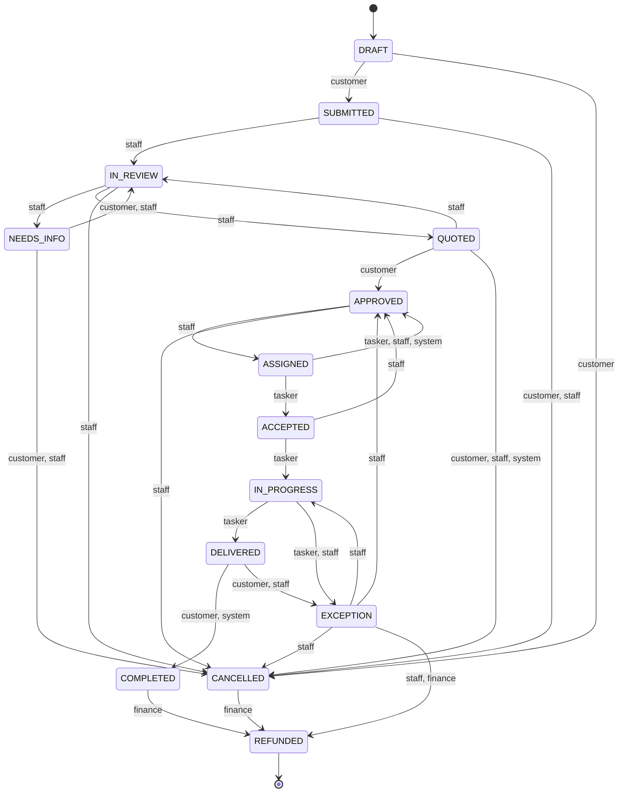

# The task state machine

A task status only ever changes through the `TaskStateMachine` service in the API
(`apps/api/src/modules/tasks/task-state-machine.service.ts`). It asks the shared transition
table, writes the change, the history row and, for staff, the audit row, all in one
transaction.

The table lives in `packages/shared/src/state-machine.ts`, so the web app, the API and the
tests all use the same rules.

## The actors

| Actor      | Who it is                                          |
| ---------- | -------------------------------------------------- |
| `customer` | The person who booked the task                     |
| `staff`    | Operations, finance and admin staff                |
| `tasker`   | The tasker who runs the task                       |
| `finance`  | The finance staff, for the money decisions         |
| `system`   | Background jobs, for example an offer that expired |

## The table

```
DRAFT        -> SUBMITTED   [customer]
              -> CANCELLED   [customer]

SUBMITTED    -> IN_REVIEW   [staff]
              -> CANCELLED   [customer, staff]

IN_REVIEW    -> NEEDS_INFO  [staff]
              -> QUOTED      [staff]
              -> CANCELLED   [staff]

NEEDS_INFO   -> IN_REVIEW   [customer, staff]
              -> CANCELLED   [customer, staff]

QUOTED       -> APPROVED    [customer]
              -> IN_REVIEW   [staff]
              -> CANCELLED   [customer, staff, system]

APPROVED     -> ASSIGNED    [staff]
              -> CANCELLED   [staff]

ASSIGNED     -> ACCEPTED    [tasker]
              -> APPROVED    [tasker (decline), staff, system (offer expired)]

ACCEPTED     -> IN_PROGRESS [tasker]
              -> APPROVED    [staff]

IN_PROGRESS  -> DELIVERED   [tasker]
              -> EXCEPTION   [tasker, staff]

DELIVERED    -> COMPLETED   [customer, system]
              -> EXCEPTION   [customer, staff]

EXCEPTION    -> IN_PROGRESS [staff]
              -> APPROVED    [staff]
              -> CANCELLED   [staff]
              -> REFUNDED    [staff, finance]

CANCELLED    -> REFUNDED    [finance]

COMPLETED    -> REFUNDED    [finance]

REFUNDED     -> (nothing)
```

Everything that is not in the table is forbidden.

## The diagram



## How a transition runs

```ts
await this.prisma.$transaction(async (tx) => {
  // The row lock makes two parallel transitions impossible.
  await tx.$queryRaw`SELECT id FROM tasks WHERE id = ${taskId}::uuid FOR UPDATE`;

  const task = await tx.task.findUnique({ where: { id: taskId } });
  if (!canTransition(task.status, to, actor.role)) {
    throw new BadRequestException({ code: 'INVALID_TRANSITION', ... });
  }

  await tx.task.update({ where: { id: taskId }, data: { status: to, ... } });
  await tx.taskStatusHistory.create({ data: { taskId, fromStatus, toStatus, actorId, actorRole, note } });

  if (actor.role is staff) {
    await this.audit.record({ action: 'task.status_changed', ... }, tx);
  }
});
```

Three things follow from this:

1. The status, the history row and the audit row are committed together or not at all.
2. A forbidden transition is a `400 INVALID_TRANSITION`, never a silent change.
3. No other code may write `Task.status`. A test reads the source of the task service and
   fails when an update sets a status.

## In Phase 2

Only three transitions are reachable from the outside:

| Action                   | Transition               |
| ------------------------ | ------------------------ |
| `POST /tasks/:id/submit` | `DRAFT -> SUBMITTED`     |
| `POST /tasks/:id/cancel` | `DRAFT -> CANCELLED`     |
| `POST /tasks/:id/cancel` | `SUBMITTED -> CANCELLED` |

Everything else becomes reachable in the later phases, using the same service.

## The history

`task_status_history` is append only: one row per change, with the old status, the new
status, who did it and when. The customer sees it as a timeline on the task page.
